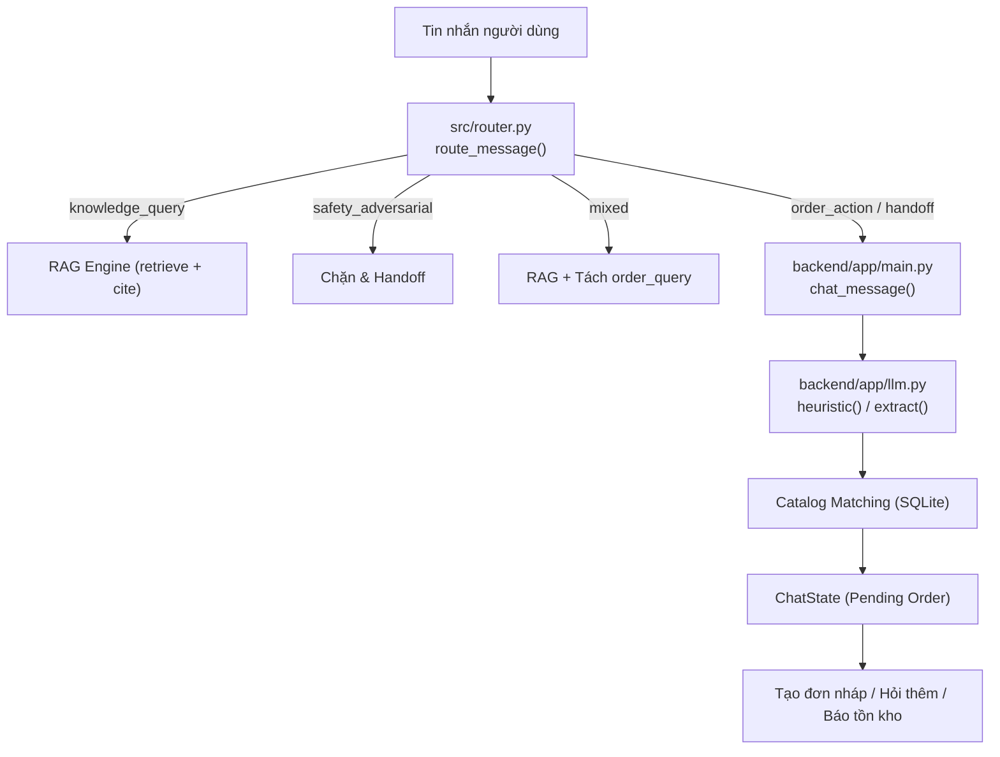

# Báo cáo Thu hoạch P0: Rà soát Baseline & Hợp đồng Trích xuất (Chatbot)

## 1. Rà soát luồng hoạt động hiện tại (Current Baseline Flow)

Hệ thống xử lý hội thoại hiện tại trải qua chuỗi xử lý tuần tự qua 4 thành phần:



### Các thành phần chính:
1. **Router (`src/router.py`)**:
   - Sử dụng regex danh sách từ khóa không dấu (`normalize_text`) để phân định: `knowledge_query`, `order_action`, `mixed`, `safety_adversarial`, `handoff`.
   - **Giới hạn**: Khi ở giữa hội thoại đa lượt (khách chỉ gửi thông tin người nhận: tên, sđt, địa chỉ), router không khớp từ khóa order nào nên fallback về `handoff` với `requires_clarification=True`. `main.py` phải kiểm tra `pending_followup` qua cờ DB `ChatState` để không bị chặn sớm.
2. **Extractor (`backend/app/llm.py`)**:
   - `norm(value)`: Loại bỏ toàn bộ dấu tiếng Việt (NFD strip).
   - Regex trích xuất tên: `(?:ten|nguoi nhan)\s*...` -> **Bắt buộc phải có nhãn**.
   - Regex trích xuất địa chỉ: `(?:địa chỉ|dia chi|giao đến|giao về)\s*...` -> **Bắt buộc phải có nhãn**.
   - Trích xuất số lượng: `\b(?:so luong|chot|mua|lay|dat)\s*(\d{1,2})\b`.
3. **Pending State & Catalog Matching (`backend/app/main.py`)**:
   - Lưu trữ dạng dictionary `pending_order` trong bảng SQLite `chat_states` với TTL 1800 giây (30 phút).
   - Đối chiếu sản phẩm: Quét toàn bộ bảng `products` đang active, so sánh chuỗi con với `requested_product`.
   - Đối chiếu variant: Yêu cầu **tất cả** thuộc tính trong variant (`attributes.values()`) phải xuất hiện trong tin nhắn.

---

## 2. Các lỗi thực tế tái hiện được (Reproducible Bugs)

Qua rà soát chi tiết mã nguồn, chúng tôi xác định được **5 điểm nghẽn/lỗi nghiêm trọng**:

| Mã lỗi | Tên lỗi | Cơ chế gây lỗi trong code | Hậu quả thực tế |
| :--- | :--- | :--- | :--- |
| **BUG-01** | **Mất thông tin người nhận không nhãn** *(Unlabeled Contact Loss)* | [`backend/app/llm.py#L79-L80`](file:///D:/VSCode/Project/RAG/backend/app/llm.py#L79-L80): Regex tên và địa chỉ bắt buộc phải có từ khóa tiền tố (`ten:`, `dia chi:`). | Khi khách nhắn: *"An, 0901234567, 123 Lê Lợi Q1"*, bot chỉ lấy được sđt, vứt bỏ tên & địa chỉ, sau đó hỏi lại đúng 2 thông tin khách vừa gửi. |
| **BUG-02** | **Ghi đè mất số lượng khi nhắc lại sản phẩm** *(Quantity Loss on Product Repeat)* | [`backend/app/main.py#L671`](file:///D:/VSCode/Project/RAG/backend/app/main.py#L671): Kiểm tra `if pending ... and not candidates:`. Nếu ở lượt sau khách nhắc lại tên sản phẩm, `candidates` không rỗng -> bỏ qua nhánh giữ state -> trôi xuống dòng 718: `pending = {**pending, "quantity": data.quantity}`. | Khách ở Turn 1 đã chốt 2 cái. Sang Turn 2 khách gửi: *"Áo thun đó giao cho Nam, 090..."*. Vì `data.quantity` ở turn 2 là `None`, `pending["quantity"]` bị ghi đè thành `None` và bot hỏi lại số lượng! |
| **BUG-03** | **Không thể hủy hoặc đổi ý giữa chừng** *(Pending State Lock / Cancellation Failure)* | Router và Handler không có nhánh nhận diện lệnh hủy pending (`"thôi không mua nữa"`, `"hủy đơn"`). | Khách đổi ý không muốn đặt nữa, nhưng session vẫn bị kẹt trong `pending_order` suốt 30 phút, các câu chat sau vẫn có thể bị hiểu nhầm là bổ sung thông tin. |
| **BUG-04** | **Mất lựa chọn thuộc tính bán phần** *(Partial Variant Selection Loss)* | `pending_order` chỉ lưu `"sku"`. Nếu khách mới chọn 1 thuộc tính (ví dụ mới chọn `"size M"` nhưng chưa chọn màu), `variant` là `None` nên không lưu được gì vào `pending`. | Ở turn sau khách nói màu sắc (`"màu xanh"`), bot quên mất khách đã chọn `"size M"` ở turn trước và tiếp tục yêu cầu chọn size lại từ đầu. |
| **BUG-05** | **Hàm xử lý phình to nguyên khối** *(Monolithic Handler)* | `chat_message()` trong [`backend/app/main.py`](file:///D:/VSCode/Project/RAG/backend/app/main.py#L535-L785) dài > 250 dòng làm quá nhiều nhiệm vụ: routing, RAG, extract, catalog match, state update, audit log, response format. | Khó viết unit test độc lập cho từng khâu, dễ gây hiệu ứng lề (side effects) khi sửa logic. |

---

## 3. Hợp đồng Trích xuất Chuẩn hóa (Standardized Extraction Contract)

Để khắc phục các hạn chế trên và làm cơ sở cho giai đoạn P1, chúng tôi định nghĩa hợp đồng trích xuất có kiểu tường minh:

```python
from pydantic import BaseModel, ConfigDict, Field

class VariantSelection(BaseModel):
    model_config = ConfigDict(extra="forbid")
    color: str | None = None
    size: str | None = None
    capacity: str | None = None
    weight: str | None = None
    grind: str | None = None

class Extraction(BaseModel):
    model_config = ConfigDict(extra="forbid")
    
    # 1. Ý định phân loại rõ ràng
    intent: str = Field(
        description="create_order | check_stock | check_price | update_order | cancel_pending | unknown_or_handoff"
    )
    
    # 2. Thực thể sản phẩm và biến thể (partial attributes)
    requested_product: str | None = Field(default=None, max_length=160)
    variant: VariantSelection | None = None
    
    # 3. Số lượng: Nghiêm ngặt từ 1..99; KHÔNG tự động gán mặc định bằng 1 nếu người dùng không nói
    quantity: int | None = Field(default=None, ge=1, le=99)
    
    # 4. Thông tin người nhận: NULL nếu không có bằng chứng rõ ràng
    name: str | None = Field(default=None, max_length=120)
    phone: str | None = Field(default=None, max_length=30)
    address: str | None = Field(default=None, max_length=500)
    
    # 5. Tham chiếu đơn hàng (nếu đang sửa đơn)
    order_reference: str | None = Field(default=None, max_length=32)
    
    # 6. Cờ trạng thái hỗ trợ điều hướng an toàn
    is_ambiguous: bool = Field(default=False, description="True khi câu có nhiều thực thể xung đột")
    requires_human_review: bool = False
```

### Quy tắc bất biến (Invariants):
1. **Strictly `null` when missing**: Tuyệt đối không tự suy diễn `quantity = 1` hoặc tự gán thông tin người nhận khi người dùng chưa cung cấp.
2. **Partial Variant State**: Cho phép lưu trữ từng phần thuộc tính đã nhận diện (`{"size": "M"}`) trong pending state để gom đủ ở các turn kế tiếp.
3. **Explicit Cancellation (`cancel_pending`)**: Có intent riêng để giải phóng `ChatState` ngay lập tức khi khách hủy.

---

## 4. Bộ Ca Kiểm thử Tổng hợp Baseline (Synthetic Cases)

Đã khởi tạo bộ test case tại [`artifacts/chatbot_baseline_cases.json`](file:///D:/VSCode/Project/RAG/artifacts/chatbot_baseline_cases.json) bao gồm:
- **MT-01**: Hội thoại đa lượt với thông tin nhận hàng hoàn toàn không nhãn (`"An, 0901234567, 123 Lê Lợi Q1"`).
- **MT-02**: Nhắc lại tên sản phẩm ở turn 2 mà không nhắc lại số lượng (chống mất `quantity`).
- **MT-03**: Bổ sung từng trường một qua 4 lượt thoại liên tiếp (kiểm tra gom slot lũy tiến).
- **MT-04**: Đổi ý và hủy đơn nháp đang chờ (xóa sạch `pending_order`).
- **ST-01**: Đặt hàng 1 lượt với đầy đủ thông tin nhưng không gắn nhãn (phải tạo đơn ngay không hỏi lại).
- **ST-02**: Xử lý từ viết tắt số lượng tiếng Việt tự nhiên (`"2c áo thun"`, `"lấy 2 cái"`).
- **ST-03**: Chống hallucination (chỉ nói tên sản phẩm -> không tự tạo đơn, phải hỏi cả số lượng và thông tin nhận hàng).
- **ST-04**: Chọn biến thể bán phần (chỉ chọn size M, phải hỏi danh sách màu tương ứng).
- **ST-05**: Prompt injection / can thiệp giá 0 đồng (phải bị chặn an toàn).
